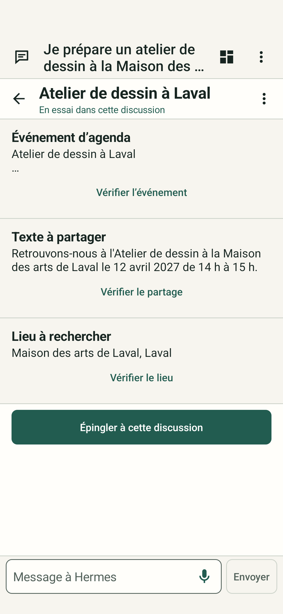
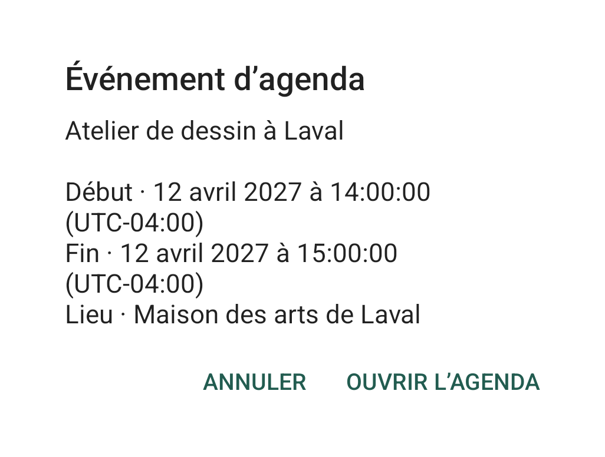
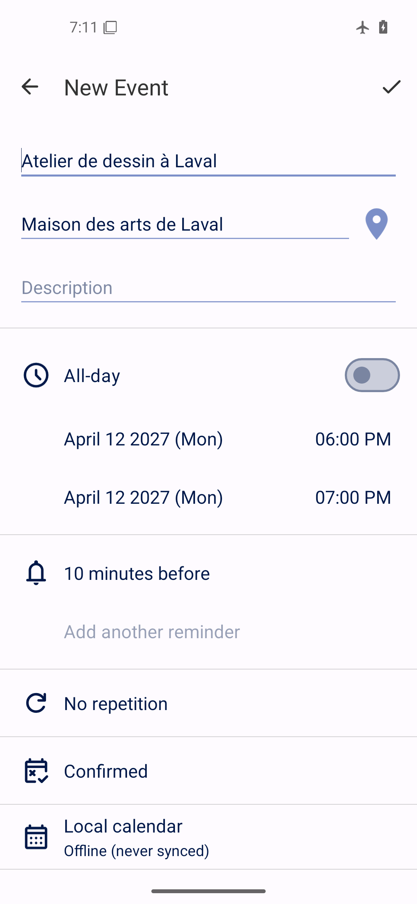
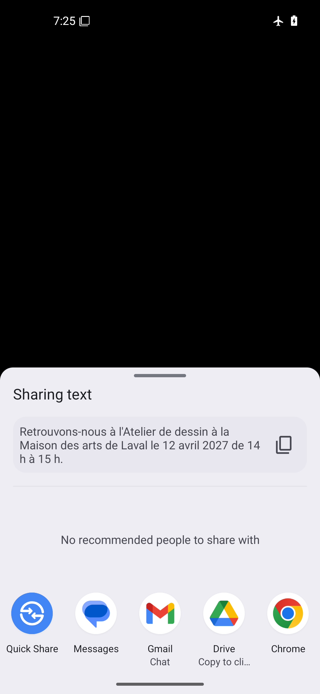
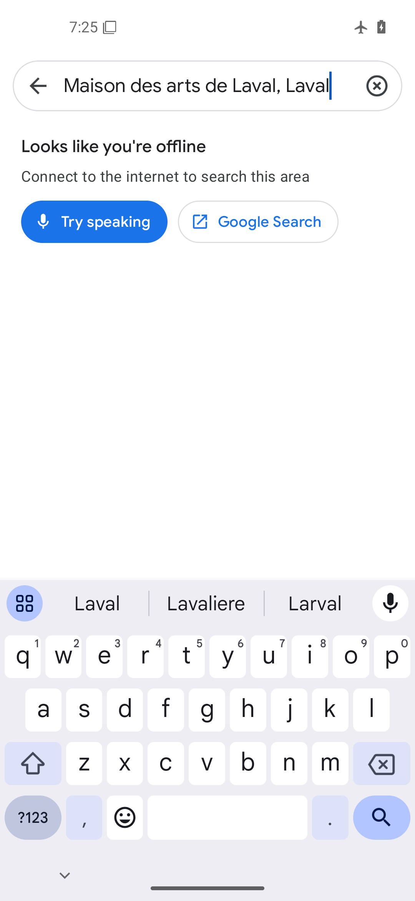

# Prepare an Android action in a conversation

Ask Hermes in your own words. “Add my drawing workshop to my calendar”, “Draft this message for my team”, and “Show me the place on the map” are all requests Hermes can turn into proposals you review on the phone. Specify the date, start and end time, and time zone for a calendar event. A place name or street address is enough for a map search.

| Request | What happens after you review and tap |
| --- | --- |
| Calendar event | Android opens a calendar editor with the title, dates and optional place. You choose whether to save. |
| Text to share | Android opens the share sheet with the proposed text. You choose a destination and finish there. |
| Place on a map | Android asks a compatible maps app to search for the proposed place. The request contains the search text. |

The proposal appears in the conversation where you asked for it. Opening, pinning or comparing a page leaves its actions pending. The receiving app and its availability depend on the device. A phone that does not recognize the block can still display the assistant’s explanation and the proposal source. Model output alone does not confirm a save or delivery. [Android common intents](https://developer.android.com/guide/components/intents-common) and [Android Sharesheet](https://developer.android.com/training/sharing/send)

## From the conversation to the calendar

On an Android 16 emulator, Hermes Mobile sent a request from its conversation composer asking Hermes to prepare a drawing workshop calendar event (April 12, 2027, 2:00 PM to 3:00 PM, UTC-04:00 at Maison des arts de Laval), a team reminder message to share, and a map search for the venue.

Local Qwen2.5-Coder-7B-Instruct returned a structured workspace page containing all three proposals. The model output matched the completed gateway run and assistant message 2 in the captured verification conversation. [Original phone request, reply and run identifiers](examples/android-actions/phone-run.json)

The tester chose **Try in discussion** and **Review event** to inspect the dates and place. **Open calendar** passed those details to the calendar. These two native view captures show the same reply replayed on a signed build, first in the conversation and then in its confirmation dialog.

<a href="examples/android-actions/proposal.png"></a>
<a href="examples/android-actions/review.png"></a>

**Calendar.** In the original model run, the tester opened Fossify Calendar. Its editor showed April 12, the workshop title, and the venue. Because the emulator used GMT, 2:00 PM to 3:00 PM local time appeared as 6:00 to 7:00 PM. The tester discarded the event so the test calendar contained zero events afterward.

<a href="examples/android-actions/calendar.png"></a>

**Sharing and maps.** In the signed-build replay, the Android Sharesheet displayed the proposed invitation message, and the tester dismissed it before choosing a recipient. Google Maps opened with the venue name in its search bar on the offline emulator.

<a href="examples/android-actions/share.png"></a>
<a href="examples/android-actions/map.png"></a>

## One request for a workshop

> Prepare a calendar appointment for the drawing workshop on April 12, 2027, from 2:00 PM to 3:00 PM in Laval (UTC-04:00). I also want to share a reminder with my team and locate Maison des arts de Laval on the map.

A compatible assistant can return this page. The calendar action carries its own dates. The map and share actions each carry only the value shown in their review.

```hermes-workspace
{
  "version": 1,
  "surface": "page/drawing-workshop",
  "mode": "replace",
  "title": "Drawing workshop",
  "blocks": [
    {
      "type": "device",
      "request": {
        "kind": "calendar_event",
        "title": "Drawing workshop",
        "start": "2027-04-12T14:00:00-04:00",
        "end": "2027-04-12T15:00:00-04:00",
        "location": "Maison des arts de Laval"
      }
    },
    {
      "type": "device",
      "request": {
        "kind": "share_text",
        "text": "Join us for the drawing workshop on April 12 at 2:00 PM at Maison des arts de Laval."
      }
    },
    {
      "type": "device",
      "request": {"kind": "map_search", "query": "Maison des arts de Laval"}
    }
  ]
}
```

## A separate host model run

A local Qwen2.5-Coder-7B-Instruct model received a natural-language request for the drawing workshop and returned a calendar event for 2:00 PM to 3:00 PM with the requested UTC-04:00 offset, a team message, and a map query for the venue. The 554-byte reply matched the provider output, the completed gateway run, and assistant message 2 in its conversation. The Android parser accepted all three blocks on the host, and the run stopped before opening a phone app. [Exact request, reply and run identifiers](examples/android-actions/model-run.json)

## What the gateway supplies

The mobile app sends its supported action shapes in the existing `instructions` field of `POST /v1/runs`. The pinned gateway passes those instructions and the selected conversation to the model. An assistant reply supplies the page document. Preparing or opening one of its device actions requires no new gateway route, plugin or provider credential. Other API clients retain their own instructions. [Pinned Hermes run admission](https://github.com/LLM-4-People/hermes-agent/blob/3f194698f9cb586d3302129e744ed30e18c3d6ff/gateway/platforms/api_server_runs.py#L949)

Requests to work on the gateway use the active profile’s tools. For example, ask Hermes to summarize research, review files in its workspace or schedule a recurring reminder. The pinned fork includes toolsets for web research, browsing, files, terminal work, skills, memory and scheduled tasks. Availability depends on configuration and the current run’s selections. Authenticated `GET /v1/capabilities` describes the API, and `GET /v1/toolsets` lists each toolset’s configuration and enabled state. The phone’s **Model and tools** panel controls the model and tools used for a discussion. [Pinned discovery handlers](https://github.com/LLM-4-People/hermes-agent/blob/3f194698f9cb586d3302129e744ed30e18c3d6ff/gateway/platforms/api_server.py#L2358), [pinned toolsets](https://github.com/LLM-4-People/hermes-agent/blob/3f194698f9cb586d3302129e744ed30e18c3d6ff/toolsets.py#L72), [Hermes API server](https://hermes-agent.nousresearch.com/docs/user-guide/features/api-server) and [Hermes tools](https://hermes-agent.nousresearch.com/docs/user-guide/features/tools)

In **Model and tools → Hermes skills**, search the enabled skills returned by the active profile’s authenticated `GET /v1/skills`. Open a summary and choose **Prepare draft** to add its loadable name to the current draft. Tap **Send** to submit. A skill can require additional configuration when Hermes opens it. [Pinned skills endpoint](https://github.com/LLM-4-People/hermes-agent/blob/3c43393e5dc075fa216d1b2cd9d60894dc0faf78/gateway/platforms/api_server.py#L2385) and [pinned catalog resolution](https://github.com/LLM-4-People/hermes-agent/blob/3c43393e5dc075fa216d1b2cd9d60894dc0faf78/tools/skills_tool.py#L292)

<!-- Generated from docs/sources/docs/android-actions.md.in by scripts/docs.py. -->
