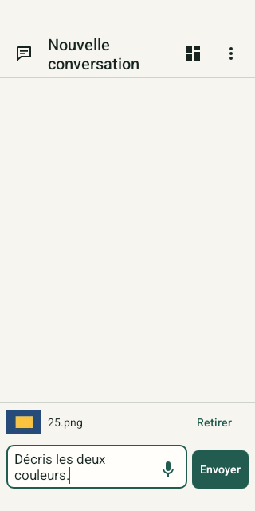
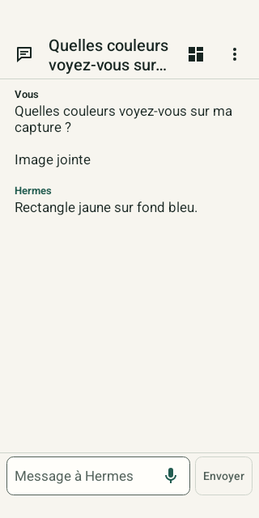
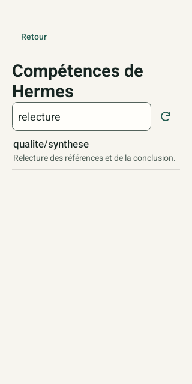
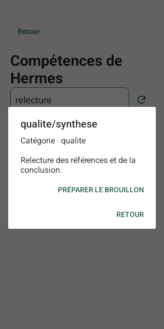
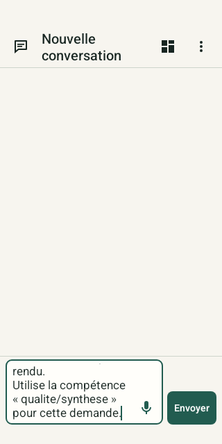
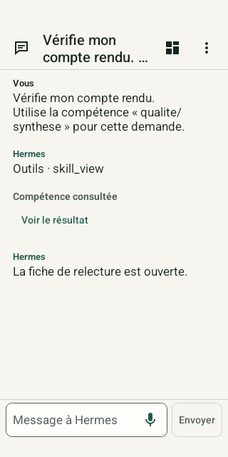

# Use a photo or an installed skill in a discussion

## Ask about a photo

Open **Autres actions → Joindre une image…** and choose a still image in Android’s picker. Its thumbnail appears above the message field. You can edit the question or tap **Retirer** to remove the image and keep your text. Tap **Envoyer** when the question and thumbnail are ready.

In this example the draft reads « Décris les deux couleurs. » The person changed it to « Quelles couleurs voyez-vous sur ma capture ? » before sending the blue image with a yellow rectangle.

The receiving test provider compared every decoded pixel with the 96 × 64 reference image before returning « Rectangle jaune sur fond bleu. » A separate gateway run used a local vision model to describe two different images. [See the vision model’s inputs and replies](local-vision.md)

## Ask Hermes to use an installed skill

In the discussion, open **Autres actions → Modèle et outils → Compétences de Hermes**. Search by name or description. Here, typing `relecture` found `qualite/synthese`, a skill installed on the test gateway for reviewing references and conclusions. Tap the result to read its summary.

Tap **Préparer le brouillon** to append the skill request to your existing text. The first line below was already in the composer. You can edit either line before tapping **Envoyer**.

> Vérifie mon compte rendu. 
> Utilise la compétence « qualite/synthese » pour cette demande.

The draft stayed on the phone until **Envoyer**. Hermes then opened the installed `qualite/synthese` file once through `skill_view`. The test provider checked its contents before replying « La fiche de relecture est ouverte. » Tap **Voir le résultat** under **Compétence consultée** to read the returned instructions. The native reader lets you select text or tap **Copier le contenu**.

Both journeys used the same Android packages and published gateway revision `3c43393`. The receipt identifies the package source, the matching public verification revision and the SHA-256 of each original screen. [Native capture receipt](examples/discussion-context/receipt.json)

<!-- Generated from docs/sources/docs/discussion-context.md.in by scripts/docs.py. -->
