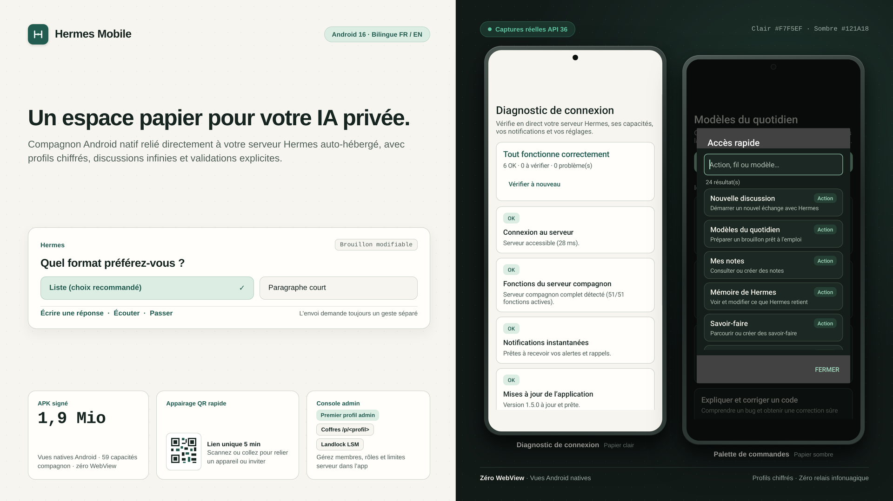
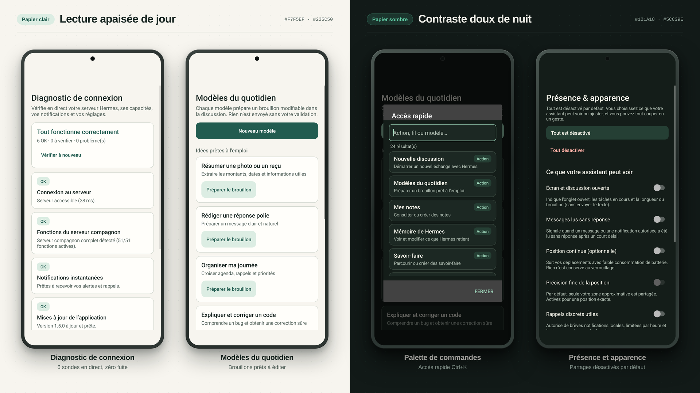
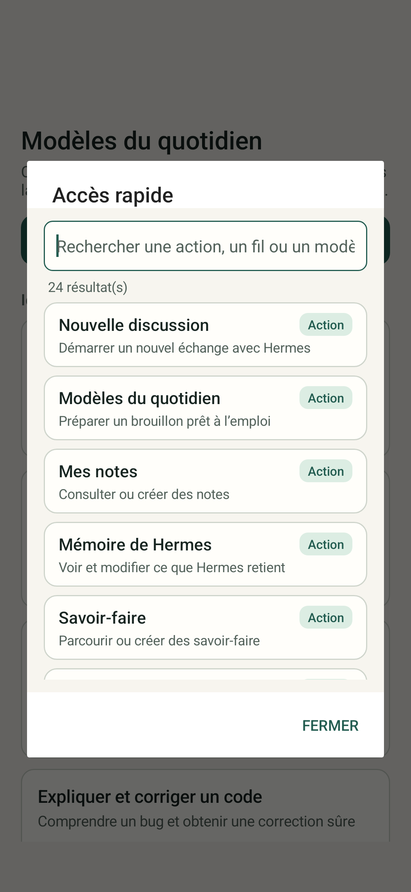
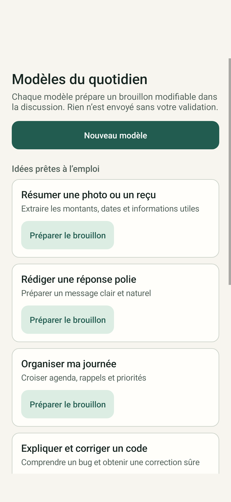
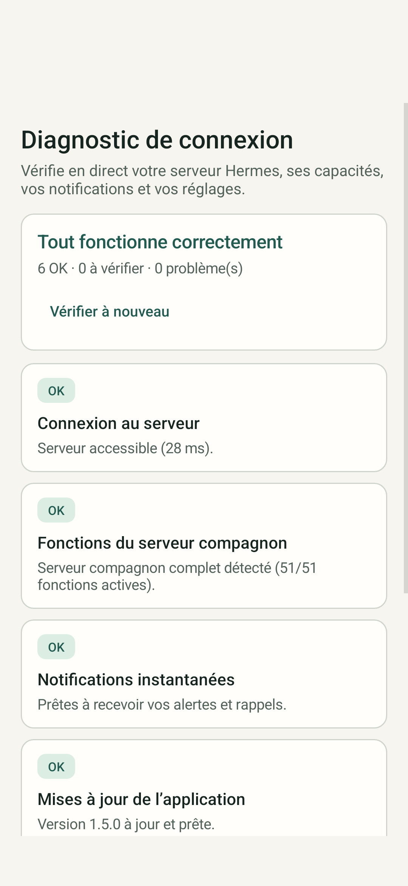
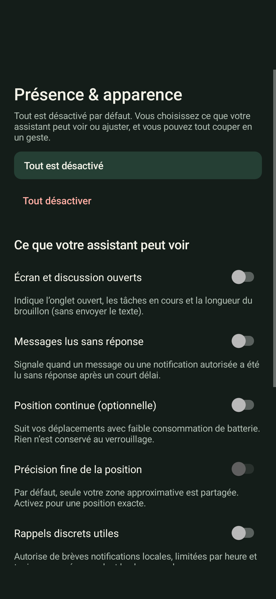

# Hermes Mobile — Documentation en français

*[English README](../../README.md) · [Portail français en ligne](https://llm-4-people.github.io/hermes-mobile/fr/) · [Télécharger la dernière version signée](https://github.com/LLM-4-People/hermes-mobile/releases/latest)*

  

**Hermes Mobile** est un client Android natif (API 28 à 36, Java, zéro WebView, APK signé d’environ 1,9 Mo) conçu pour discuter, programmer, valider des actions, lancer plusieurs tâches simultanées et personnaliser votre espace avec votre propre serveur Hermes. L’application suit automatiquement la langue de votre téléphone (**français** ou **anglais**), offre un changement en un geste et synchronise cette préférence avec votre serveur.

> **Serveur compagnon requis :** Hermes Mobile fonctionne avec notre branche compagnon **[LLM-4-People/hermes-agent](https://github.com/LLM-4-People/hermes-agent)**, qui fournit l’hébergement multi-profils sur un seul nom de domaine (`/p/{profil}`), l’exécution simultanée de plusieurs tâches par utilisateur, les modifications d’interface en direct, les notifications privées, les notes, la recherche et le partage entre profils, les aperçus visuels de modifications et le pont d’actions Android.

## Aperçu sur appareil réel

  

  
  
  
  

## Ce que fait Hermes Mobile

| Domaine | Capacités principales |
| --- | --- |
| **Interface adaptative à 3 onglets, recherche universelle et Réglages** | Trois espaces vivants (**Discussions** avec filtres **Toutes · Épinglées · Partagées**, **Notes et tâches** réunissant Notes, Rappels et **Réception**, et **Apps** pour la voix, vos écrans et vos modèles) ainsi que la **Recherche universelle** et le centre **Réglages** (incluant **Thème, palette et mise en page**) accessibles depuis la barre supérieure sur chaque écran. Barre inférieure sensible au clavier sur téléphone et barre latérale de **92 dp** avec volet repliable (`232–360 dp`) sur tablette. |
| **Recherche universelle, palette rapide (`Ctrl+K`) et modèles quotidiens** | Recherchez vos discussions, notes, éléments partagés, réglages et outils depuis n’importe quel écran (résultats locaux instantanés + recherche FTS5 sur le serveur) ou ouvrez la palette au clavier (`Ctrl+K`). Inclut 6 modèles quotidiens prêts à l’emploi et vos propres modèles chiffrés par profil, toujours placés en brouillon modifiable avant l’envoi. |
| **Tâches simultanées et isolation multi-utilisateurs** | Lancez plusieurs tâches en parallèle dans différentes discussions sans interrompre les flux en cours ni mélanger les réponses, tout en hébergeant plusieurs utilisateurs sur **un seul domaine HTTPS** (`/p/<profil>`) avec des dossiers, espaces et clés strictement isolés. |
| **Discussions instantanées et performances optimisées** | Changement de discussion instantané avec chargement progressif de l’historique, affichage fluide des réponses en continu, vues personnalisées sans allocation superflue, caches mémoire purgés au verrouillage et APK signé allégé d’environ **1,9 Mo** (**-19 %**). |
| **Diagnostic de connexion en direct** | Sous **Réglages → Diagnostic de connexion**, six contrôles parallèles vérifient la joignabilité et la latence du serveur, les 51 fonctions du serveur compagnon, les notifications, les mises à jour, l’accès ambiant et la langue, avec boutons de correction directe et copie d’un rapport expurgé sans aucune clé ni donnée privée. |
| **Code, comparaisons visuelles et voix mains libres** | Réponses en continu avec mise en forme enrichie, lecteur de code coloré, cartes d’approbation visuelles, dictée locale ou système, lecture vocale hors ligne et mode vocal mains libres avec interruption instantanée. |
| **Studio d’apparence, personnalisation en direct et widgets d’accueil** | Ajustez le thème, la palette (contraste WCAG-AA `4.5:1` garanti jour et nuit), la densité, la taille de texte et l’onglet de démarrage dans **Réglages → Thème, palette et mise en page**, ou demandez à Hermes d’adapter un écran ou de créer un outil interactif avec aperçu, historique d’annulation complet et widgets d’écran d’accueil liés à votre profil. |
| **Coffre chiffré et centre d’autorisations** | Stockage local chiffré par profil avec verrouillage au choix (**Biométrie / téléphone**, **code PIN de 6 à 12 chiffres** ou **phrase secrète de 12 caractères ou plus**), délai de verrouillage intelligent par défaut de **5 minutes** (personnalisable), temporisation persistante, effacement atomique de profil, centre **Réglages → Autorisations Android** (un geste pour **Autoriser** ou **Ouvrir les réglages Android**), notifications en direct Android 16, tuile de paramètres rapides et raccourcis d’application. |
| **Notes, partage intégré et outils avancés** | Créez et filtrez vos notes intelligentes (**Mes notes · Partagées avec moi**) dans **Notes et tâches**, consultez les discussions partagées directement dans **Discussions**, gérez la mémoire, les savoir-faire et les fichiers du projet dans **Réglages**, validez des habitudes suggérées après au moins trois répétitions et partagez sept types d’éléments entre utilisateurs du même serveur. |
| **Accès ambiant privé par défaut** | Entièrement désactivé par défaut pour chaque profil. Liste blanche d’applications filtrée par un garde-fou qui bloque systématiquement les codes à usage unique, gestionnaires de mots de passe, banques et notifications masquées. |
| **Notifications privées sans fuite** | Fonctionne avec Firebase ou avec un relais auto-hébergé UnifiedPush (ntfy chiffré). Aucune notification ne transporte le texte de vos messages : tout reste sur votre serveur jusqu’au déverrouillage du profil. |
| **Capture universelle et 11 actions Android** | Partagez du texte, des photos (métadonnées EXIF, GPS et ICC supprimées dans de nouveaux pixels sRGB), des documents ou des prises de vue caméra dans n’importe quelle discussion. Vérifiez et lancez 11 actions Android natives : agenda, feuille de partage, recherche sur carte, itinéraire, alarme, minuteur, composeur téléphonique, SMS, courriel, fiche contact et copie sensible dans le presse-papiers. [Actions Android](../android-actions.md) |

## Démarrage rapide

### 1. Installer l’application signée et rester à jour

1. Téléchargez `hermes-mobile-v0.2.1.apk`, `SHA256SUMS` et `release.json` depuis la [dernière version publiée sur GitHub](https://github.com/LLM-4-People/hermes-mobile/releases/latest).
2. Une fois installée, ouvrez **Réglages → Mises à jour de l’application** dans l’application : les nouvelles versions sont vérifiées par empreinte SHA-256 et certificat de signature correspondant avant l’installation Android native.

### 2. Connecter un profil sur un serveur HTTPS partagé

1. Déployez le serveur compagnon ([LLM-4-People/hermes-agent](https://github.com/LLM-4-People/hermes-agent)) derrière **une seule adresse HTTPS** (par exemple `https://hermes.example.com`) où chaque personne dispose de son chemin isolé `/p/<profil>` et de sa propre clé d’accès.
2. Dans **Connecter Hermes**, saisissez un nom de profil, l’adresse HTTPS du serveur, votre identifiant **Profil serveur** et votre clé d’accès.
3. Protégez le coffre local selon votre choix (**Biométrie / téléphone**, **code PIN à 6–12 chiffres** ou **phrase secrète de 12+ caractères**), puis ajustez le délai de verrouillage (5 min par défaut) ou vos accès Android dans **Réglages → Verrouillage et délai automatique** et **Réglages → Autorisations Android**.

## Liens utiles

- [Portail de présentation français](https://llm-4-people.github.io/hermes-mobile/fr/)
- [Documentation interactive en français](https://llm-4-people.github.io/hermes-mobile/fr/docs/)
- [Galerie des écrans réels en français](https://llm-4-people.github.io/hermes-mobile/fr/walkthrough/)
- [Documentation technique complète en anglais](../../README.md)

<!-- Generated from docs/sources/docs/fr/README.md.in by scripts/docs.py. -->
