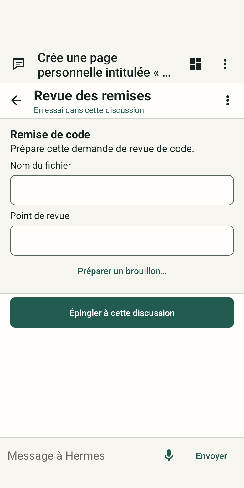
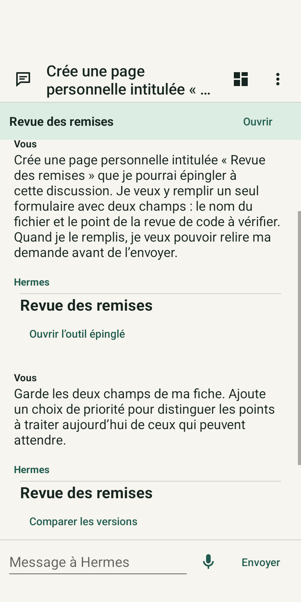
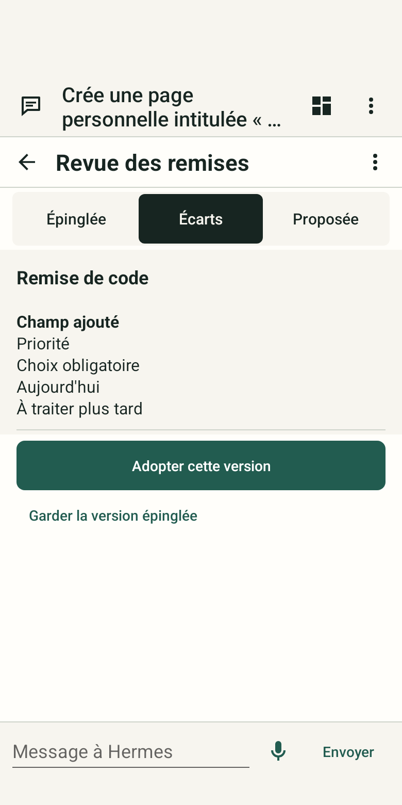
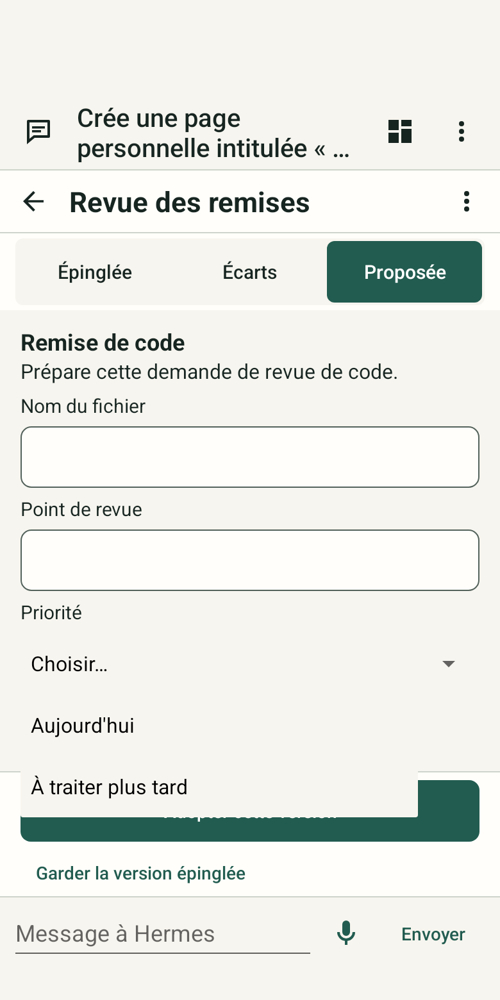

# Turn a code review into a form on Android

A local Qwen2.5-Coder-7B-Instruct model answered two French requests through the Hermes gateway. The Android app reopened those same two replies from the conversation. The screenshots show the form it rendered, the changes it found and the choices it offered.

## Ask for a form

> Crée une page personnelle intitulée « Revue des remises » que je pourrai épingler à cette discussion. Je veux y remplir un seul formulaire avec deux champs : le nom du fichier et le point de la revue de code à vérifier. Quand je le remplis, je veux pouvoir relire ma demande avant de l’envoyer.

The first reply created **Revue des remises** (`page/revue-remises`) with **Nom du fichier** (`nom-fichier`) and **Point de revue** (`point-revise`). **Préparer un brouillon…** prepares an editable message. **Épingler à cette discussion** keeps the form in this thread.

## Add a priority choice

> Garde les deux champs de ma fiche. Ajoute un choix de priorité pour distinguer les points à traiter aujourd’hui de ceux qui peuvent attendre.

After the first form was pinned, the discussion offered **Ouvrir l’outil épinglé** on the original reply and **Comparer les versions** on the revision.

## Compare the two versions

The revision kept the same page and both field IDs. **Écarts** shows one added required field, **Priorité** (`priorite`). In **Proposée**, its menu offers **Aujourd'hui** and **À traiter plus tard**. The person can inspect these choices before selecting **Adopter cette version** or **Garder la version épinglée**.

The phone displayed the original assistant messages `2` and `5` from this example conversation. Both reply texts matched the completed gateway runs byte for byte. The receipt contains the exact replies, model and build identifiers, and SHA-256 hashes for the four original captures. [Redacted capture receipt](examples/revue-des-remises/receipt.json)

<!-- Generated from docs/sources/docs/local-model-review.md.in by scripts/docs.py. -->
